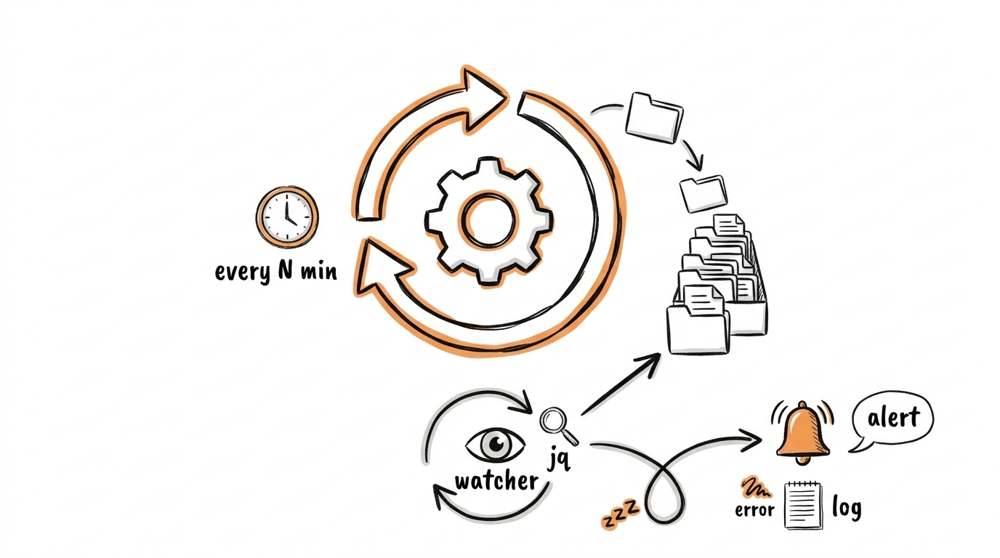

# Tutorial: Your First Fleet Scan

A hands-on walkthrough of fleet-scan end to end: build the CLI, pick a small
set of clusters, run a real scan, and query the results. For full flag and
collector reference, see the main [README](../../README.md) and
[docs/collectors/](../collectors/).

## Assumes

This tutorial assumes the following are already installed — see the
README's [Prerequisites](../../README.md#prerequisites) section if not:

- Go 1.25+
- [OCM CLI](https://github.com/openshift-online/ocm-cli)
- [Backplane CLI](https://github.com/openshift/backplane-cli)

It does not cover installing any of these — only verifying and configuring
them.

## Verify and configure prerequisites

```bash
go version            # expect go1.25 or newer
ocm version
ocm-backplane version # or: ocm backplane version
```

If `ocm-backplane version` reports an old release, run `ocm backplane
upgrade` — fleet-scan shells out to this CLI once per cluster, and an
outdated version can produce confusing login failures.

Log in and confirm the login worked:

```bash
ocm login --use-auth-code --url=prd
ocm whoami
```

`ocm whoami` also gives you your account and organization IDs, which the
next step uses.

## 1. Clone and build

```bash
mkdir -p ~/Repos
cd ~/Repos
git clone git@github.com:squirrd/fleet-scan.git
cd fleet-scan
make build
./bin/fleet-scan version
```

(`make deploy` also symlinks the binary onto your `PATH` — see the README's
[Build](../../README.md#build) section.)

## 2. Set up a scan workspace

Keep the demo's output separate from the repo checkout:

```bash
mkdir -p ~/Documents/fleetscan/tutorial
```

Everything fleet-scan writes in this tutorial goes under
`~/Documents/fleetscan/tutorial/output/`, via `--output-dir`.

## 3. Pick a set of clusters

For this demo you want a deterministic, bounded list rather than "every
managed cluster you can see" — large enough to show fleet-scan's
fleet-wide value, but still a known quantity going in.

A clean way to get that list without hardcoding any cluster IDs: resolve
them from your own OCM organization via the accounts_mgmt API, capped
with `size`:

```bash
ORG_ID=$(ocm whoami | jq -r '.organization.id')

IN_CLAUSE=$(ocm get "/api/accounts_mgmt/v1/subscriptions?search=organization_id%3D%27${ORG_ID}%27%20AND%20status%3D%27Active%27%20AND%20managed%3D%27true%27&size=50" \
  | jq -r '[.items[].cluster_id] | map("\x27" + . + "\x27") | join(",")')

echo "$IN_CLAUSE"
```

Raise or lower `size` to change how many clusters the demo covers.

> **Note:** scoping to your whole organization surfaces clusters created
> by other people, not just your own — and at `size=50` that can be a
> meaningful slice of everyone's test clusters at once. Because the live
> scan step below logs into every matched cluster via backplane, make
> sure you have a legitimate reason — and your organization's go-ahead —
> before running this against clusters you didn't create yourself. To
> stay scoped to only your own clusters, filter by `creator.id` (from
> `ocm whoami`) instead of `organization_id`.

Confirm the query resolves before running anything against it:

```bash
./bin/fleet-scan scan --search "id in ($IN_CLAUSE)" --dry-run
```

This should report a cluster count of up to 50 (fewer if your
organization doesn't have that many active managed clusters) — no
backplane logins are performed for a `--dry-run`.

## 4. Run the scan

This tutorial uses the `ns-attribution` collector: it returns a flat list
of slim per-resource metadata (namespace, name, kind, labels, ownership)
rather than full raw Kubernetes objects, which makes it easy to read and
easy to query with `jq`. See
[docs/collectors/ns-attribution.md](../collectors/ns-attribution.md) for
the full parameter reference, and
[docs/collectors/](../collectors/) for the other available collectors.

```bash
./bin/fleet-scan scan \
  --search "id in ($IN_CLAUSE)" \
  --collector "ns-attribution:patterns=kube-system,openshift-*;kinds=ServiceAccounts,Deployments" \
  --concurrency 15 \
  --cluster-timeout 300 \
  --output-dir ~/Documents/fleetscan/tutorial/output/ \
  --verbose
```

`--concurrency 15` keeps a 50-cluster run from taking forever — raise it
further if your network/backplane setup handles it comfortably.

Expect a status line per cluster, e.g. (truncated — a 50-cluster run
produces 50 of these):

```
[1/50] <cluster-name> (ok, 12.3s)
[2/50] <cluster-name> (skipped, 14.1s)
...
[50/50] <cluster-name> (ok, 9.8s)
Done: 50 clusters (N ok, M error, K skipped) in <duration> -> .../output/<run-id>/
```

It's normal — and expected behavior, not a bug — for some clusters to come
back `skipped`. A backplane login can fail for operational reasons (access
protection enabled, cluster under load, a stale backplane session). Per
fleet-scan's error-handling convention, a login failure skips that
cluster's collectors, captures the error in the output, and the run
continues with the rest.

## 5. Inspect the output

```bash
RUN_DIR=$(ls -d ~/Documents/fleetscan/tutorial/output/*/ | tail -1)
cat "$RUN_DIR/meta.json"
```

`meta.json` reports the search used, which collectors ran, and outcome
counts (`clusters_success`, `clusters_failed`, `clusters_skipped`).
`results.jsonl` has one line per cluster — cluster metadata plus each
collector's result. Cap how many lines you look at and pipe through `jq`
to pretty-print, rather than dumping the whole file:

```bash
head -n 5 "$RUN_DIR/results.jsonl" | jq .
```

## 6. Example queries

```bash
RESULTS="$RUN_DIR/results.jsonl"

# Which clusters were skipped, and why
jq -c 'select(.cluster_result["ns-attribution"].status == "skipped")
  | {cluster: .cluster_metadata.name, error: .cluster_result["ns-attribution"].error}' "$RESULTS"

# Resource count by kind across the fleet
jq -r '.cluster_result["ns-attribution"].data.resources[]?.kind' "$RESULTS" \
  | sort | uniq -c | sort -rn

# Resources by namespace
jq -r '.cluster_result["ns-attribution"].data.resources[]?.namespace' "$RESULTS" \
  | sort | uniq -c | sort -rn

# Non-platform-managed resources (attribution: who/what actually owns this)
jq -r '
  .cluster_result["ns-attribution"].data.resources[]?
  | select(.managedFields[]?.manager | test("kube-|openshift-|operator|controller|system") | not)
  | [.namespace, .kind, .name, .managedFields[0].manager]
  | @tsv
' "$RESULTS" | sort | uniq -c | sort -rn
```

More analysis queries — including CSV export and per-cluster breakdowns —
are in [docs/collectors/ns-attribution.md](../collectors/ns-attribution.md#analysis-queries).

## Next steps: ad-hoc monitoring



Everything above is a one-off run, but the same pieces extend naturally
into ad-hoc monitoring, decoupled into two independent loops:

- **Scan loop** — wrap `fleet-scan scan` in a loop that re-runs on an
  interval (`sleep`, or a cron job), each run landing in its own
  timestamped output directory exactly as it does today.
- **Watch loop** — a separate loop reads only the most recently completed
  run's `results.jsonl` with `jq`, checks for a condition worth raising,
  and fires a notification (Slack webhook, pager, etc.) when it finds one.

```bash
# scan loop: re-run every 15 minutes, one timestamped run directory per iteration
while true; do
  fleet-scan scan \
    --search "id in ($IN_CLAUSE)" \
    --collector "<some-collector>" \
    --output-dir ~/fleetscan-monitor/
  sleep 900
done
```

```bash
# watch loop: check only the latest completed run, alert on a match
while true; do
  LATEST=$(ls -dt ~/fleetscan-monitor/*/ | head -1)
  jq -c '
    select(.cluster_result["<some-collector>"].data.errors[]? | test("<pattern>"))
    | {cluster: .cluster_metadata.name, match: .cluster_result["<some-collector>"].data.errors}
  ' "$LATEST/results.jsonl" | while read -r hit; do
    echo "ALERT: $hit"   # replace with a real notification
  done
  sleep 60
done
```

The two loops don't know about each other — the scan loop doesn't care
who's watching its output, and the watch loop doesn't care how often
scans happen, only that `results.jsonl` keeps getting refreshed.

A concrete example: monitor an organization's clusters and alert if any
cluster's etcd logs show a specific error pattern. There's no etcd-log
collector today, so this is a design idea rather than something you can
run as-is — but `cco-tight-loop` already shows the shape such a collector
would take: it inspects a rolling time window of operator logs and
reports matches above a threshold (see
[docs/collectors/](../collectors/)). An etcd-error collector built the
same way would slot into the watch loop above unchanged.
